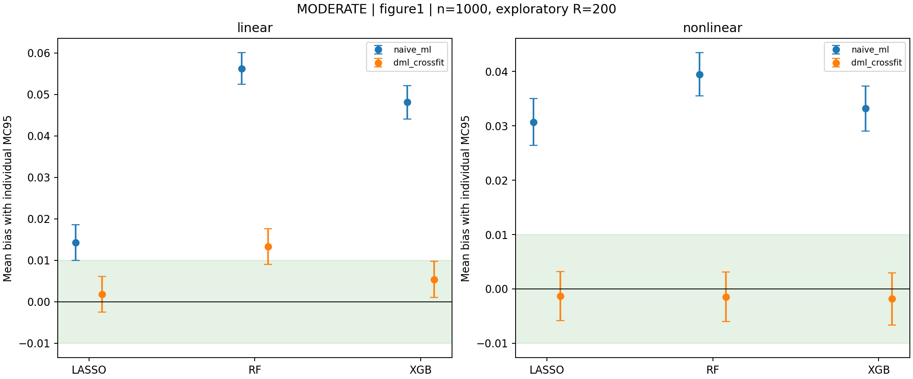
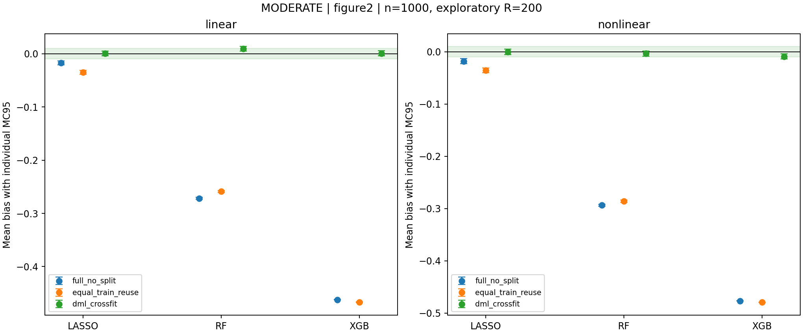

> Repository presentation copy: an offline raw-archive link points to RAW_EVIDENCE.md. Original reports and execution identifiers are preserved separately; scientific results are unchanged.

# Slightly harder paired extension v5: complete exploratory results

The user-requested modest difficulty extension is complete on the authorized
server. This is an exploratory 200-replication-per-cell extension, NOT a
replacement of the previous 1000-replication controlled v4 results. n=1000
and theta=.5 throughout; all fitting/tests/replays ran on the server.

## Main outcome

All three learner families still reduce mean bias in both original mechanism
experiments at the moderate difficulty level. Equal-weight aggregation of
ABSOLUTE mean bias over the six moderate learner/DGP cells shows an 88.7%
reduction for naive ML -> DML and 98.5% for full No-split -> Cross-fitting.
No signed-bias cancellation is used in these aggregates.

The larger DGP exposes limitations: linear Figure 1 RF DML has residual bias
.013278, MC95 [.008985,.017570], despite reduction from naive bias .056246.
Against this extension's matched baseline, its DML bias increases from
.007013 by .006264, paired MC95 [.005462,.007067]. This is a real measured
change under shared random numbers, not evidence that the earlier v4 result
was fabricated or that all difficult cases must have zero bias.

Among 18 moderate within-level method comparisons, 16 support MAE improvement
and 16 support MSE improvement AFTER separate Holm corrections over all 36
baseline+moderate comparisons for each metric. The two exceptions are Lasso
full No-split vs Cross-fit (both DGPs); point MAE/MSE improve, but the adjusted
evidence is insufficient at this exploratory replication count. The Lasso
same-500-row-bank reuse comparisons DO support improvement. There is no claim
that every comparison significantly improves every metric.

All 18 moderate paired percentile-bootstrap absolute-mean-bias-change intervals
are negative, but these are explicitly exploratory, especially near zero bias.
They are not a simultaneous guarantee, a regular unbiasedness test, or a
substitute for the disclosed MAE/MSE exceptions. Nothing was retuned or extended
after reading these results.

## How the modest difficulty increase was defined

Keep n=1000,p=20, original design coefficients, theta=.5, correlation .7,
unit Gaussian U,V, two folds, and every v4 learner penalty/capacity setting.
Raise the true active-variable count from two to four:

| DGP | Added treatment-function terms | Added outcome-function terms |
| --- | --- | --- |
| Linear | .20*x4 + .15*x6 | .15*x4 + .15*x6 |
| Nonlinear | .20*x4 + .20*sigmoid(x6) | .25*sigmoid(x4) + .20*x6 + .30*tanh(x0)*tanh(x4) |

The nonlinear interaction is bounded in magnitude by .30. It appears only in
g, leaving m additive and monotone, so the positive treatment constraints are
not deliberately false. Lasso/pilot dictionaries do NOT receive the interaction;
the nonlinear Lasso outcome channel therefore faces explicit misspecification.

The baseline and moderate levels receive the identical candidate treatment
inputs x0,x2,x4,x6 (two irrelevant candidates at baseline). Nonlinear Lasso m
also receives their sigmoid features. Both levels use exactly the same model
settings and seeds. Shared X,U,V and fold assignments make difficulty comparisons
paired. Noise and theta stay fixed, but signal variance changes; this is a
combined-complexity test, not an isolated dimension/interaction or fixed-SNR test.
This remains a controlled known-candidate-input experiment, NOT unrestricted
discovery among all 20 inputs.

The new baseline is not numerically identical to v4: it uses four common
treatment candidates and a new independent seed. Use the paired baseline in
THIS extension for difficulty attribution, not differences against older runs.
The [frozen protocol](HARDER_V5_PROTOCOL.md) and
[exact configuration](../configs/harder_v5.json) preserve all assumptions.

## Moderate Figure 1: naive ML versus IV DML

Both estimators use the SAME held-out structural g predictions. Signed mean
biases below equal mean estimates minus .5; R=200 per cell.

| DGP | Learner | Naive bias | DML bias | DML MC95 bias interval | DML RMSE | DML coverage |
| --- | --- | ---: | ---: | --- | ---: | ---: |
| Linear | Lasso | +.014256 | +.001782 | [-.002529,+.006092] | .030886 | 97.0% |
| Linear | RF | +.056246 | +.013278 | [+.008985,+.017570] | .033457 | 93.0% |
| Linear | XGBoost | +.048094 | +.005397 | [+.001087,+.009707] | .031299 | 97.0% |
| Nonlinear | Lasso | +.030683 | -.001320 | [-.005799,+.003159] | .032068 | 95.0% |
| Nonlinear | RF | +.039472 | -.001453 | [-.006007,+.003101] | .032612 | 95.5% |
| Nonlinear | XGBoost | +.033192 | -.001849 | [-.006628,+.002929] | .034233 | 95.0% |

## Moderate Figure 2: full No-split, exact-bank reuse, Cross-fitting

All arms use the same learner rules and g=ell-training_pilot*m construction,
with the structural IV final score. No artificial own-response term is added.
Full No-split trains on 1000 rows. Exact-bank reuse and Cross-fitting use the
same two 500-row fitted models, targets, pilots, and random states.

| DGP | Learner | Full No-split bias | Exact-bank reuse bias | Cross-fit bias | Cross-fit MC95 bias interval | Cross-fit RMSE | Coverage |
| --- | --- | ---: | ---: | ---: | --- | ---: | ---: |
| Linear | Lasso | -.017004 | -.034810 | +.000442 | [-.003878,+.004763] | .030912 | 95.5% |
| Linear | RF | -.271606 | -.258874 | +.009246 | [+.004908,+.013584] | .032383 | 95.0% |
| Linear | XGBoost | -.462098 | -.466839 | +.000724 | [-.004060,+.005508] | .034232 | 96.5% |
| Nonlinear | Lasso | -.017852 | -.035725 | -.000207 | [-.005200,+.004787] | .035723 | 92.0% |
| Nonlinear | RF | -.293613 | -.285737 | -.003401 | [-.008357,+.001556] | .035622 | 93.5% |
| Nonlinear | XGBoost | -.476719 | -.479352 | -.008923 | [-.014065,-.003781] | .037850 | 93.0% |

## What changed relative to the NEW matched baseline?

| Experiment | DGP | Learner | Baseline Cross-fit bias | Moderate Cross-fit bias |
| --- | --- | --- | ---: | ---: |
| Figure 1 | Linear | Lasso | +.001989 | +.001782 |
| Figure 1 | Linear | RF | +.007013 | +.013278 |
| Figure 1 | Linear | XGBoost | +.004162 | +.005397 |
| Figure 1 | Nonlinear | Lasso | -.001179 | -.001320 |
| Figure 1 | Nonlinear | RF | -.000865 | -.001453 |
| Figure 1 | Nonlinear | XGBoost | -.001004 | -.001849 |
| Figure 2 | Linear | Lasso | +.000533 | +.000442 |
| Figure 2 | Linear | RF | +.005432 | +.009246 |
| Figure 2 | Linear | XGBoost | +.000429 | +.000724 |
| Figure 2 | Nonlinear | Lasso | -.000434 | -.000207 |
| Figure 2 | Nonlinear | RF | -.007718 | -.003401 |
| Figure 2 | Nonlinear | XGBoost | -.008332 | -.008923 |

Difficulty does NOT require every signed or absolute bias to increase.
For example nonlinear Figure 2 RF mean bias becomes LESS negative. Retain this
result rather than select only worsening cells. The complete paired difficulty
contrasts include mean-estimate, MAE/MSE and nuisance-error changes for all
30 estimator combinations, with individual intervals.

Learning difficulty is also visible in nuisance errors: Figure 1 linear RF m
RMSE grows .2199 -> .2706; Figure 2 linear RF m RMSE .2702 -> .3360. Nonlinear
Figure 1 Lasso g RMSE grows .1211 -> .1887 when the interaction is omitted.
These measurements reflect the combined structural/signal changes, not isolated
proof that a specific added component causes the entire change.

## Explicit inconclusive Lasso full No-split comparisons

| Moderate DGP | Paired MAE change (CF minus NS), MC95 | Holm MAE p | Paired MSE change, MC95 | Holm MSE p |
| --- | --- | ---: | --- | ---: |
| Linear | -.001447 [-.003767,+.000872] | .1100 | -.000124 [-.000280,+.000031] | .1000 |
| Nonlinear | -.002348 [-.004917,+.000220] | .1094 | -.000170 [-.000371,+.000031] | .1000 |

Lower absolute mean bias does not automatically imply statistically established
improvement in every per-replication loss. A longer independent confirmation
could clarify small effects, but was NOT launched based on these results.

## Limits

This is R=200 exploratory evidence. Do not describe it as the previous R=1000
formal run or pool it with v4. RF linear Figure 1 and nonlinear Figure 2 XGB
have detectable residual bias. Neither all-model exact unbiasedness nor
unconditional complex-DGP robustness is established. The model input/shape
priors are disclosed, and 95% coverage itself has substantial Monte Carlo
uncertainty at R=200. Full Wilson intervals are in the raw summary.

## All sixteen figures

Every histogram is three actual learner rows, two method columns, blue
standardized-error density versus red N(0,1), with shared x range/bins per
paired row, all tails retained, no re-centering. Statistics are above axes.

### Moderate level

- [Figure 1 linear histogram](../output/harder_v5_server_20261002/output/exploratory/analysis/moderate_figure1_linear_naive_ml_hist.png)
- [Figure 1 nonlinear histogram](../output/harder_v5_server_20261002/output/exploratory/analysis/moderate_figure1_nonlinear_naive_ml_hist.png)
- [Figure 2 linear full No-split histogram](../output/harder_v5_server_20261002/output/exploratory/analysis/moderate_figure2_linear_full_no_split_hist.png)
- [Figure 2 nonlinear full No-split histogram](../output/harder_v5_server_20261002/output/exploratory/analysis/moderate_figure2_nonlinear_full_no_split_hist.png)
- [Figure 2 linear exact-bank reuse histogram](../output/harder_v5_server_20261002/output/exploratory/analysis/moderate_figure2_linear_equal_train_reuse_hist.png)
- [Figure 2 nonlinear exact-bank reuse histogram](../output/harder_v5_server_20261002/output/exploratory/analysis/moderate_figure2_nonlinear_equal_train_reuse_hist.png)
- [Figure 1 bias](../output/harder_v5_server_20261002/output/exploratory/analysis/moderate_figure1_bias.png)
- [Figure 2 bias](../output/harder_v5_server_20261002/output/exploratory/analysis/moderate_figure2_bias.png)

### New paired baseline

- [Figure 1 linear histogram](../output/harder_v5_server_20261002/output/exploratory/analysis/baseline_figure1_linear_naive_ml_hist.png)
- [Figure 1 nonlinear histogram](../output/harder_v5_server_20261002/output/exploratory/analysis/baseline_figure1_nonlinear_naive_ml_hist.png)
- [Figure 2 linear full No-split histogram](../output/harder_v5_server_20261002/output/exploratory/analysis/baseline_figure2_linear_full_no_split_hist.png)
- [Figure 2 nonlinear full No-split histogram](../output/harder_v5_server_20261002/output/exploratory/analysis/baseline_figure2_nonlinear_full_no_split_hist.png)
- [Figure 2 linear exact-bank reuse histogram](../output/harder_v5_server_20261002/output/exploratory/analysis/baseline_figure2_linear_equal_train_reuse_hist.png)
- [Figure 2 nonlinear exact-bank reuse histogram](../output/harder_v5_server_20261002/output/exploratory/analysis/baseline_figure2_nonlinear_equal_train_reuse_hist.png)
- [Figure 1 bias](../output/harder_v5_server_20261002/output/exploratory/analysis/baseline_figure1_bias.png)
- [Figure 2 bias](../output/harder_v5_server_20261002/output/exploratory/analysis/baseline_figure2_bias.png)

## Verification and provenance

Server `/data2/lzx/dhy/dml_harder_v5_20261002`, one launch, 24 one-thread CPU
workers, no GPU, read-only reuse of the existing isolated v3 environment.
Exploration took about 8.1 minutes before analysis. 800 paired draws / 1600
level-replications / 12000 estimates; zero experiment warnings or failures.

25 software tests passed; 24 actual DoubleML external-prediction score/SE
checks matched within 1e-12 (score parity, NOT fitting-pipeline equivalence).
The checker separately records 96 package-deprecation warnings. Independent
source/hash/universe/common-XUV/bank/statistics/bootstrap/Holm verification
passed for 60 cells, 36 method contrasts, 30 difficulty contrasts and 16 PNGs.
Four existing replication-0 paired receipts replayed exactly (60 estimator
rows); duplicates are excluded from statistics. Downloaded archive, 800 receipt
and 16 figure hashes match; eight moderate-level figures were visually inspected.
Only local syntax/hash/read/display work occurred; NO local fitting.

Identity:
`f6fe9c69118e99972aea93b50722ef68943183c67a10219b0c11a8a360d79bc8`

Evidence archive SHA-256:
`971c57a5a5d2d3bb3f87bd2f98e58c5b53a0670d586b41cd31004ae66f0f56e3`

[Complete raw summary](../output/harder_v5_server_20261002/output/exploratory/analysis/SUMMARY.json),
[independent verification](../output/harder_v5_server_20261002/INDEPENDENT_VERIFICATION.json),
[exact existing-record replays](../output/harder_v5_server_20261002/SOFTWARE_REPLAY_CHECK.json),
[all frozen code/results/figures](RAW_EVIDENCE.md).

Earlier v4 and ordinary negative-results evidence remains unchanged.
