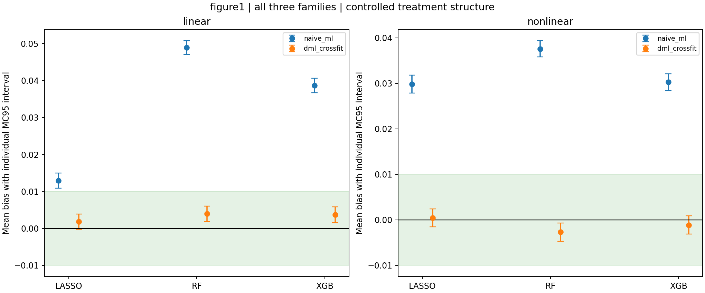
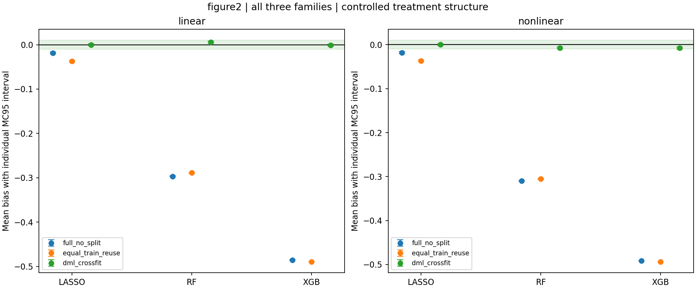

> Repository presentation copy: an offline raw-archive link points to RAW_EVIDENCE.md. Original reports and execution identifiers are preserved separately; scientific results are unchanged.

# Three-family two-claim IV simulation: complete controlled v4 results

All requested learner families are now present in BOTH experiments and BOTH
learned nuisance channels: Lasso, Random Forest, XGBoost. All fits and tests
ran on `rna-server`, not locally. The experiment is complete; the scientific
claim of exact finite-sample unbiasedness is NOT established.

## What the complete results support

In every one of the six linear/nonlinear learner cells, genuine naive ML
has detectable positive mean bias and DML strongly reduces it. In every
one of the six second-experiment cells, full No-split and equal-training
sample reuse have detectable negative bias and Cross-fitting strongly
reduces it. ALL 18 paired comparisons have negative MC95 intervals for
the change in absolute estimation error and squared estimation error.

All 12 Cross-fit point biases have magnitude below .008. Eleven of twelve
meet the PREDECLARED practical-zero rule: the entire individual MC95
mean-bias interval lies in [-.01,.01]. The nonlinear Figure 2 XGBoost cell
is inconclusive under this rule: bias -.007793, interval
[-.010136,-.005449], just beyond the boundary. Do NOT round the interval to
make it pass, relax the criterion, add replications after seeing it, or
hide the cell. Six of twelve small RF/XGB biases are statistically detectable
despite passing practical equivalence; that is NOT exact unbiasedness.

## Controlled assumptions, not an ordinary unrestricted learner benchmark

The original four DGPs and n=1000,p=20,theta=.5 are unchanged. Compared
with the earlier ordinary all-20-input runs, treatment learners are given
the known relevant columns x0,x2 and their positive monotonic directions.
RF/XGB still learn m from observed D, with their own monotone models.
Lasso uses a weak positive penalty and a declared raw/sigmoid basis. No
oracle coefficients, g0, m0, noise values, or theta0 enter fitting.

Outcome learners receive all 20 input columns; nonlinear Lasso and the
overfitting-test Lasso also receive the fixed sigmoid dictionary. The
shared training-only joint Lasso pilot is internal, not a final estimator.
There is no Series OLS or standalone Decision Tree substitution. The
final DML score is structural IV-type throughout. These results therefore
do NOT overturn the earlier ordinary learner negative results or prove
that arbitrary RF/XGB/Lasso settings are finite-sample unbiased.

See [the frozen protocol](TWO_CLAIMS_V4_PROTOCOL.md) and
[all exact model settings](../configs/two_claims_v4.json).

## Experiment 1: genuine naive ML versus orthogonal DML

Both estimators use the SAME held-out structural g predictions. g is
trained on Y minus the training-only pilot times D; ell is never passed
as structural g. Naive uses raw D; DML uses D-m. Values below are signed
mean biases, NOT mean absolute errors. R=1000 for every cell.

| DGP | Learner | Naive mean bias | DML mean bias | DML MC95 bias interval | Practical-zero supported | DML 95% coverage |
| --- | --- | ---: | ---: | --- | --- | ---: |
| Linear | Lasso | +.012946 | +.001823 | [-.000260, +.003907] | Yes | 93.9% |
| Linear | RF | +.048910 | +.003945 | [+.001841, +.006048] | Yes | 94.0% |
| Linear | XGBoost | +.038626 | +.003706 | [+.001566, +.005847] | Yes | 94.0% |
| Nonlinear | Lasso | +.029793 | +.000406 | [-.001565, +.002377] | Yes | 95.1% |
| Nonlinear | RF | +.037564 | -.002701 | [-.004712, -.000690] | Yes | 95.5% |
| Nonlinear | XGBoost | +.030258 | -.001121 | [-.003158, +.000917] | Yes | 95.5% |

RF's absolute mean bias falls by approximately 91.9% (linear) and 92.8%
(nonlinear), with the treatment channel also learned by RF, not OLS.

## Experiment 2: No-split versus Cross-fitting

Both arms use the same high-capacity learner rule for ell and the same
controlled same-family treatment learner. Construct g=ell-pilot*m on its
training sample and use the IV score. There is NO artificial own-response
term added only to No-split. A deep RF or long/deep XGB ensemble genuinely
fits its own training responses; weakly penalized 40-basis Lasso has its
own real finite-sample training leverage.

Full No-split trains on 1000 observations. Equal-training reuse and
Cross-fitting assemble predictions from EXACTLY the same pair of fitted
500-row models, pilots, targets and seeds. Thus the latter comparison
removes training-size differences entirely.

| DGP | Learner | Full No-split bias | Same-bank reuse bias | Cross-fit bias | Cross-fit MC95 bias interval | Practical-zero supported | Cross-fit coverage |
| --- | --- | ---: | ---: | ---: | --- | --- | ---: |
| Linear | Lasso | -.018568 | -.037317 | -.000114 | [-.002241, +.002013] | Yes | 93.4% |
| Linear | RF | -.296707 | -.288908 | +.005795 | [+.003585, +.008006] | Yes | 92.1% |
| Linear | XGBoost | -.485356 | -.489233 | -.001394 | [-.003804, +.001017] | Yes | 93.0% |
| Nonlinear | Lasso | -.018155 | -.036704 | +.000119 | [-.001957, +.002196] | Yes | 95.3% |
| Nonlinear | RF | -.309691 | -.305435 | -.007251 | [-.009375, -.005128] | Yes | 94.7% |
| Nonlinear | XGBoost | -.491661 | -.493643 | -.007793 | [-.010136, -.005449] | Inconclusive | 93.4% |

The true effect is .5. For example, RF mean estimates are .203293 versus
.505795 (linear full No-split/Cross-fit), and .190309 versus .492749
(nonlinear). This is conditional controlled-mechanism evidence, not a
claim that ordinary default RF produces these results.

## Remaining bias and inference limits

Cross-fitting removes training-response dependence, not the second-order
nuisance product. For the nonlinear Figure 2 XGB cell, the exact mean
weighted decomposition is approximately:

| Component | Contribution to mean bias |
| --- | ---: |
| Oracle sampling term | +.000282 |
| First-order nuisance term | -.000473 |
| Second-order nuisance product | -.007602 |
| Total | -.007793 |

This identifies residual nuisance-product error, NOT unequal backgrounds
or a fold assembly error. No parameters were adjusted after observing it.
The 95% coverage rates range from 92.1% to 95.5%; low mean bias alone does
not establish perfect inference. Intervals are individual-cell intervals,
not a simultaneous 95% guarantee across all cells. Monte Carlo evidence
cannot prove exact unbiasedness at fixed n=1000.

## Original-style histograms: all learners and both DGPs

Three rows are Lasso/RF/XGBoost, two columns are the compared methods.
Blue histograms show (estimate-.5)/estimated SE; the red curve is N(0,1).
There is no Monte Carlo re-centering, seed filtering, or cropped tail.
Within each paired learner row both columns have identical x ranges and
bin edges. RF/XGB overfit panels have wide axes because their No-split
distributions are far from zero; the Cross-fit panels are not re-scaled
to exaggerate agreement.

- [Naive ML versus DML: linear](../output/two_claims_v4_server_20261002/output/formal/analysis/figure1_linear_naive_ml_hist.png)
- [Naive ML versus DML: nonlinear](../output/two_claims_v4_server_20261002/output/formal/analysis/figure1_nonlinear_naive_ml_hist.png)
- [Full No-split versus Cross-fit: linear](../output/two_claims_v4_server_20261002/output/formal/analysis/figure2_linear_full_no_split_hist.png)
- [Full No-split versus Cross-fit: nonlinear](../output/two_claims_v4_server_20261002/output/formal/analysis/figure2_nonlinear_full_no_split_hist.png)
- [Exact same-bank reuse versus Cross-fit: linear](../output/two_claims_v4_server_20261002/output/formal/analysis/figure2_linear_equal_train_reuse_hist.png)
- [Exact same-bank reuse versus Cross-fit: nonlinear](../output/two_claims_v4_server_20261002/output/formal/analysis/figure2_nonlinear_equal_train_reuse_hist.png)

## Verification and provenance

Server: `/data2/lzx/dhy/dml_two_claims_v4_20261002`, one formal launch,
24 one-thread CPU workers, no GPU, unchanged read-only v3 isolated Python
environment. Formal run finished in about 17.4 minutes before analysis.
4000 replications, 30000 estimates, zero formal failures/warnings.

- 23 software tests passed, including test-response isolation for BOTH
  experiments and all three families, model types, and monotonicity.
- 12 actual DoubleML 0.10.1 external-prediction IV-score checks matched
  coefficients and SEs to 1e-12. This is SCORE parity, not equivalence
  to the package's default nuisance fitting. Its 32 package-deprecation
  warnings are retained separately from the zero formal-fit warnings.
- Independent source/hash/universe/paired-bank/statistics/decomposition
  verification passed: 30 summary cells and 18 paired contrasts.
- Four original replication-0 receipts, covering all 30 estimator rows,
  replayed exactly on the server; duplicates are excluded from MC results.
- Downloaded archive SHA and all 4000 receipt / eight figure hashes match.
  All eight figures were visually inspected. No local fitting occurred.

Formal identity:
`3c67d809c25401a82b7e1b61f9edaebdb0def7889c0608c33eb4968fc5d19a5e`

Evidence bundle SHA-256:
`de661d292d08b92fb00695c1d6d088072ccc2d23a092cddf6fdf3bf5a743e0fe`

[Complete machine-readable results](../output/two_claims_v4_server_20261002/output/formal/analysis/SUMMARY.json),
[independent verification](../output/two_claims_v4_server_20261002/INDEPENDENT_VERIFICATION.json),
[exact software replay](../output/two_claims_v4_server_20261002/SOFTWARE_REPLAY_CHECK.json),
[frozen source and all raw evidence](RAW_EVIDENCE.md).

Historical ordinary IV v1, equal-training v1, and Series/Tree controlled
v3 artifacts are untouched. The current result is an additional controlled
three-family experiment, not a replacement of unfavorable older evidence.
